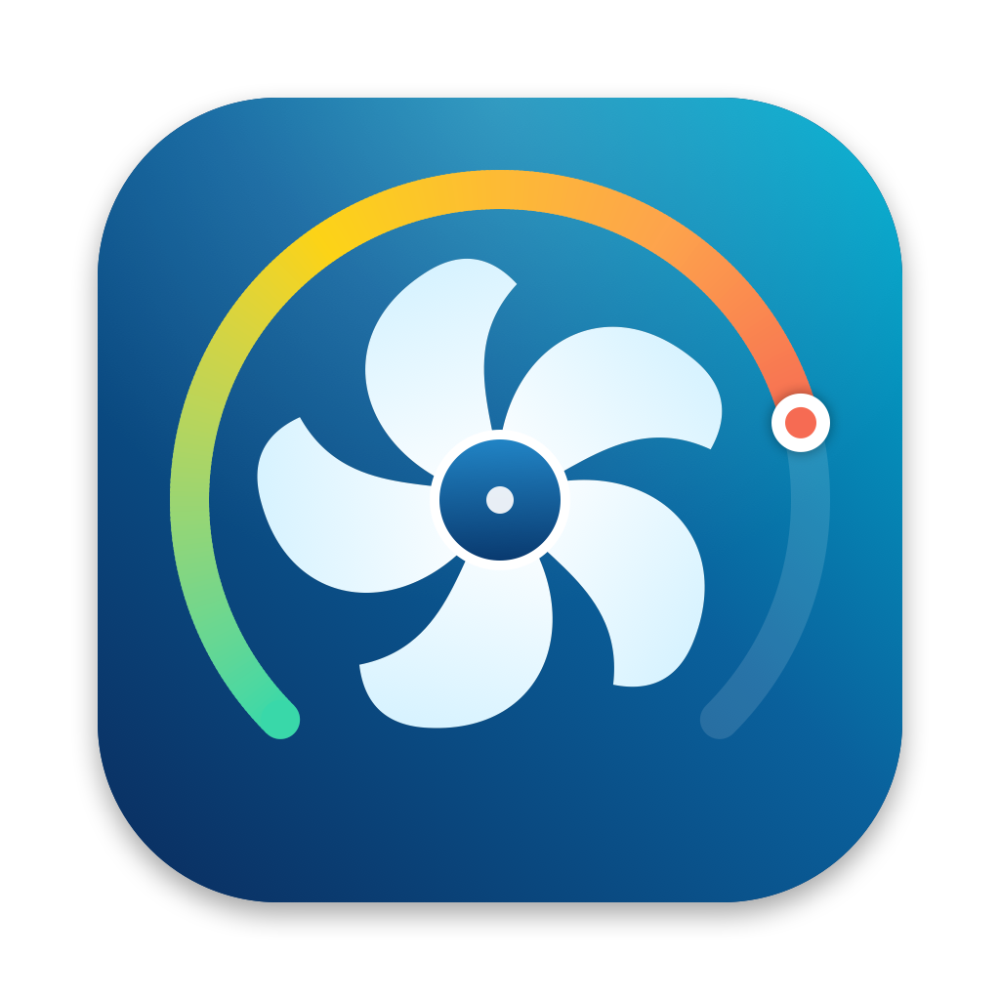

<p align="center">
  
</p>

<h1 align="center">ThermoPilot</h1>

<p align="center">
  <b>Températures, ventilateurs et santé de la batterie pour Mac Apple Silicon, directement dans la barre des menus.</b><br>
  Gratuit, open source, et plus léger que les problèmes qu'il surveille (&lt; 0,2 % de CPU).
</p>

<p align="center">
  <a href="../../releases/latest"></a>
  
  <a href="LICENSE"></a>
  <a href="CONTRIBUTING.md"></a>
</p>

<p align="center">
  <a href="../../releases/latest"><b>⬇️ Télécharger</b></a> ·
  <a href="README.md">English</a>
</p>

<p align="center">
  <a href="assets/demo.mp4"></a><br>
  <sub>▶️ <a href="assets/demo.mp4">Voir la démo de 30 secondes avec le son</a></sub>
</p>

---

## Pourquoi ThermoPilot ?

Mon MacBook Pro M3 Max chauffe sous charge, et certains jours la batterie se vidait bien plus vite que d'autres, sans que je sache pourquoi.
Les outils existants couvrent chacun un morceau : ventilateurs, températures ou limite de charge. **ThermoPilot fait les trois, et explique ce qui se passe.**

- 🌡️ **Voir** tous les capteurs de température de la puce, en direct.
- 🌀 **Piloter** les ventilateurs : laisser macOS décider, fixer une vitesse ou choisir une courbe.
- 🔋 **Protéger** la batterie : limiter la charge à 80 %, avec une protection thermique.
- 📉 **Comprendre** la décharge : est-elle normale ? Quelles apps vident la batterie, et qu'est-ce qui réveille le Mac la nuit ?

Une app SwiftUI native avec un moteur en Rust, dans la barre des menus, **gratuite et open source** (MIT).
**L'objectif est de la faire évoluer ensemble : idées, retours et contributions sont les bienvenus.**

## ✨ Fonctions

- **Tableau de bord thermique** : cœurs performance et efficacité, GPU, SoC, SSD, batterie, Wi-Fi, repose-poignets, flux d'air, toutes les clés SMC brutes, et un historique sur 1, 5 ou 10 min. Un conseiller indique quand accélérer les ventilateurs.
- **Ventilateurs** : Auto (macOS), Manuel (0–100 %) ou Courbe (Silencieux / Équilibré / Performance). Ils sont rendus à macOS 5 s après la fermeture de l'app, avant la veille ou à l'arrêt du helper, et forcés au maximum au-delà de 100 °C.
- **Batterie** : limiteur de charge (50–100 %) avec protection thermique ; santé calculée comme macOS, cycles, température, puissance ; réglages d'alimentation en un clic, avec sauvegarde et restauration.
- **« Ma décharge est-elle normale ? »** : décharge en utilisation, au repos et en veille, comparée à des repères ; historique sur 7 jours ; apps qui vident la batterie ; apps qui empêchent la veille ; causes des réveils ; corrections en un clic.
- Interface en **français et en anglais**, qui suit la langue de macOS.

## 📦 Installation

1. **[Téléchargez le DMG](../../releases/latest)**, ouvrez-le et glissez **ThermoPilot** dans **Applications**.
2. **Premier lancement** : l'app n'est pas encore notarisée par Apple, donc macOS la bloque la première fois.
   - **Réglages Système › Confidentialité et sécurité** : tout en bas, cliquez sur **Ouvrir quand même**, ou
   - dans le Terminal :
     ```bash
     xattr -dr com.apple.quarantine /Applications/ThermoPilot.app
     ```
3. *(Facultatif)* Pour **piloter les ventilateurs et la charge** : pastille en haut à droite du tableau de bord › **Installer le helper root…** (mot de passe administrateur, une seule fois).

**Configuration requise** : Mac Apple Silicon (M1 à M4), macOS 15 Sequoia ou plus récent.
**Désinstaller** : pastille › **Désinstaller le helper root…**, puis mettez l'app à la corbeille.

## 🔒 Sécurité

Le helper root n'accepte que votre compte utilisateur et root. Les ventilateurs reviennent toujours à macOS, et l'adaptateur secteur est toujours réactivé avant la veille et à l'arrêt du helper. Seule une courte liste de réglages `pmset` peut être modifiée. Tout le code est ouvert : voir [`engine/src`](engine/src).
L'app est fournie telle quelle, sans garantie.

## 🤝 Contribuer

**ThermoPilot a vocation à évoluer avec sa communauté.** Toute aide compte, même sans coder :

- 🧪 **Testez-le sur votre Mac** : il n'a été testé que sur un MacBook Pro M3 Max. → [Ouvrir un rapport matériel](../../issues/new?template=hardware_report.yml)
- 🐛 Signalez des **bugs**, 💡 proposez des **idées** dans les [Issues](../../issues).
- 🌍 **Traduisez** l'app dans votre langue.
- 🛠️ Envoyez une **pull request** : voir **[CONTRIBUTING.md](CONTRIBUTING.md)**.

## 🗺️ Feuille de route

- [ ] Support vérifié des puces **M1 / M2 / M4**
- [ ] **Limiteur de charge** sur les puces qui ont une clé de pause de charge
- [ ] **Notarisation Apple** et **Homebrew**
- [ ] **Lancement au démarrage** et mises à jour automatiques
- [ ] Plus de **langues**, **widgets**, export CSV de l'historique

## 🏗️ Compiler depuis les sources

Il faut Rust (stable) et Xcode 16+ / Swift 6.

```bash
git clone https://github.com/lilian-hurst/ThermoPilot.git
cd ThermoPilot
./build.sh
open build/ThermoPilot.app
```

## Licence

[MIT](LICENSE) © lilian-hurst
