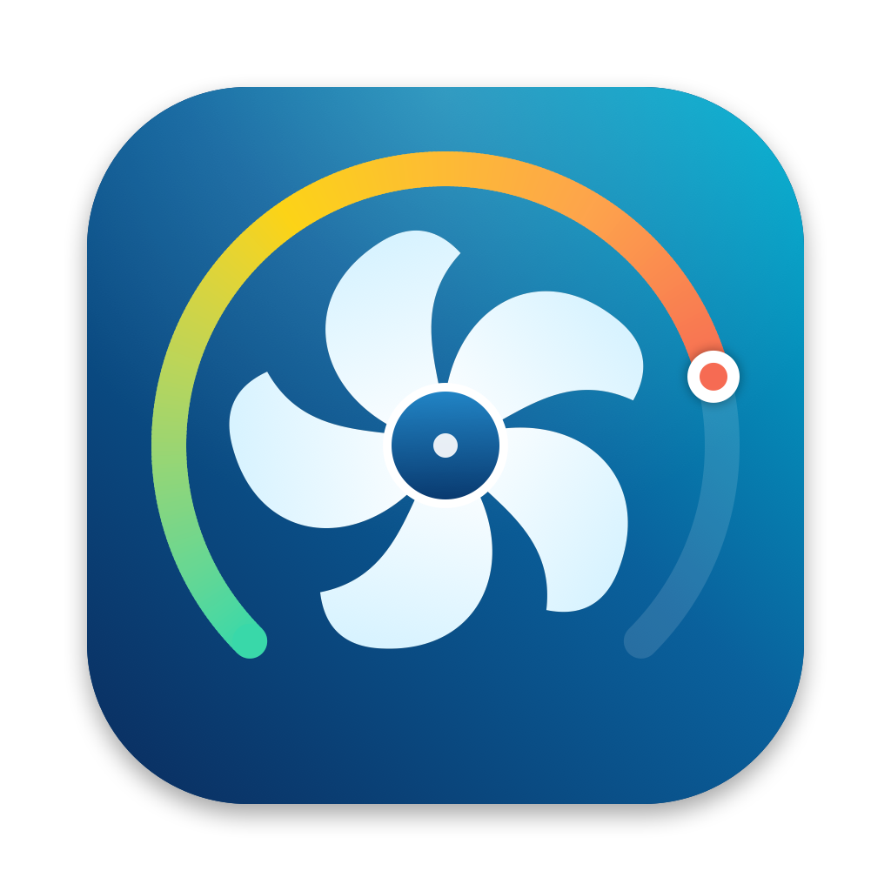

<p align="center"></p>

# ThermoPilot — températures, ventilateurs et batterie pour Mac Apple Silicon

Surveille les températures CPU/GPU, pilote les ventilateurs, conseille quand les accélérer,
et maximise l'autonomie et la durée de vie de la batterie (limiteur de charge, diagnostic de décharge, apps gourmandes).
Vit dans la barre des menus et consomme moins de 0,2 % de CPU. Interface **SwiftUI** + moteur **Rust**.

## Télécharger

➡️ **[Dernière version (DMG)](../../releases/latest)** — ouvrez le DMG et glissez ThermoPilot dans Applications.

**Configuration requise** : Mac Apple Silicon (testé sur MacBook Pro M3 Max), macOS 15 Sequoia ou plus récent.

**Premier lancement** : si l'app n'est pas notarisée par Apple, macOS affiche « ThermoPilot ne peut pas être ouvert ».
- Réglages Système › Confidentialité et sécurité › tout en bas : **Ouvrir quand même**, ou
- dans le Terminal :
  ```bash
  xattr -dr com.apple.quarantine /Applications/ThermoPilot.app
  ```

**Piloter les ventilateurs et la charge** : menu de la pastille en haut du tableau de bord › **Installer le helper root…**
(mot de passe administrateur, une seule fois). Sans helper, l'app fonctionne en lecture seule.

**Désinstaller** : pastille › « Désinstaller le helper », puis mettre l'app à la corbeille.

> ⚠️ Piloter les ventilateurs et la charge écrit dans le SMC du Mac. ThermoPilot rend toujours la main à macOS
> (app quittée, veille, arrêt du helper) et force les ventilateurs au maximum au-delà de 100 °C, mais utilisez-le à vos risques.

```
┌──────────────────────┐   JSON-lines / socket Unix   ┌───────────────────────────┐
│ ThermoPilot.app      │ ───────────────────────────▶ │ fanengine (Rust)          │
│ SwiftUI + Charts     │   status / set_mode          │ IOKit → AppleSMC          │
│ fenêtre + barre menus│ ◀─────────────────────────── │ capteurs, courbes, conseil│
└──────────────────────┘                              └───────────────────────────┘
```

## Fonctions
- Températures CPU (cœurs P / E), GPU, SoC, SSD, batterie, Wi-Fi, repose-poignets, flux d'air (+ toutes les clés SMC brutes)
- Vitesse des 2 ventilateurs (RPM, min/max, consigne, mode), charge CPU (par cœur), charge GPU, puissance système
- Historique 1 / 5 / 10 min
- Contrôle : **Auto (macOS)**, **Manuel** (0–100 %), **Courbe** (Silencieux / Équilibré / Performance)
- **Conseiller** : niveau (frais → critique), tendance °C/min, ventilation conseillée, bouton « Appliquer », notifications
- **App quittée = macOS reprend la main** : dès qu'aucune instance de ThermoPilot n'est connectée au helper depuis 5 s
  (app quittée ou plantée), les ventilateurs repassent en Auto (macOS). Fermer seulement la fenêtre ne compte pas : l'app reste dans la barre des menus.
- **Sécurité** : en mode Manuel/Courbe, si le point chaud dépasse 100 °C les ventilateurs passent au max (jusqu'à < 92 °C) ; à l'arrêt du helper le contrôle est rendu à macOS

## Batterie : autonomie & durée de vie (onglet « Batterie »)
- **Mesures** : charge, santé (capacité réelle / d'origine), cycles, température, puissance entrante/sortante, autonomie estimée, adaptateur
- **Limiteur de charge** (helper root) : limite 50–100 %, protection thermique (pause > 35 °C), redescente à la limite.
  Le moteur détecte les clés SMC du firmware (`CHTE` / `CH0B`+`CH0C` pour la pause de charge, `CHIE` / `CH0I` pour couper l'adaptateur)
  et **vérifie l'effet réel** (courant batterie). Sur ce MacBook Pro M3 Max, seule `CHIE` existe : mode « navigation »
  (adaptateur coupé à la limite, réactivé 5 points plus bas, et toujours réactivé avant la veille et à l'arrêt du helper).
- **Réglages macOS (pmset)** par profil batterie / secteur : mode d'énergie, extinction écran, veille, Power Nap,
  bouton « Optimiser l'autonomie » (réglages précédents sauvegardés, bouton « Restaurer »)
- **Plus gros consommateurs** : énergie réelle par processus (`ri_energy_nj`), bouton « Quitter » pour les apps
- **Conseils** générés par le moteur Rust, avec action en un clic (limiter à 80 %, passer en Automatique, éteindre l'écran,
  couper Power Nap, ventilateurs en Auto sur batterie, quitter une app gourmande…). Détecte aussi les autres gestionnaires de charge
  (script `battery`, AlDente) pour éviter les conflits.

### Utilisation & diagnostic (Batterie › « Utilisation & diagnostic »)
- **Est-ce normal ?** Trois mesures comparées à des repères MacBook Pro Apple Silicon, plus un verdict global :
  décharge en utilisation (%/h, normal ≤ 8 en usage léger et ≤ 15 en usage soutenu, pondérée par la charge CPU),
  consommation au repos écran allumé (W, normal ≤ 7 W) et vidange en veille (%/h, normal ≤ 0,5 soit ≈ 4 % par nuit).
- **Comment la batterie a été utilisée** : courbe de charge sur 24 h / 7 jours (plages branché / en veille),
  un tableau par jour (temps éveillé et en veille sur batterie, % consommés, rythme coloré, temps branché, réveils),
  la liste des sessions sur batterie et les veilles avec leur nombre de réveils et leur cause principale.
- **Apps qui vident la batterie** : énergie (Wh, part en %, W moyens, minutes CPU) cumulée *uniquement pendant la décharge*,
  sur 24 h et 7 jours, plus la part « écran, Wi-Fi et reste du système » (mesure batterie moins somme des apps).
- **Que faire ?** Recommandations ciblées : conseil spécifique selon l'app (navigateur, Electron, Spotlight, Docker/VM,
  modèles IA, WindowServer…) avec un bouton « Quitter », apps qui empêchent la veille (`pmset -g assertions`),
  et pour une veille gourmande : couper TCP keep-alive ou Power Nap sur batterie, appareils Bluetooth qui réveillent le Mac.
- **Sources** : le journal d'alimentation macOS (`pmset -g log`, ~7 jours, lisible sans root, donc l'historique existe dès l'installation)
  et l'enregistreur du moteur (1 point/min, énergie par app). Avec le helper root, l'enregistrement continue même app fermée.
  Les données sont dans `/Library/Application Support/ThermoPilot/usage.json` (7 jours glissants).

## Sobriété (consommation de ThermoPilot lui-même)
- **Cadence adaptative du moteur** : 1 s quand une fenêtre est visible ou quand ThermoPilot pilote les ventilateurs,
  5 s quand l'app est seulement dans la barre des menus, 10 s quand elle est fermée.
- **Lectures au strict nécessaire** : app fermée, seuls les capteurs batterie sont lus (le SMC coûte ~0,2 ms par clé, 168 clés) ;
  app en arrière-plan, 1 capteur sur 4 dans les gros groupes ; bornes des ventilateurs lues une seule fois.
- **Aucun processus lancé en routine** : détection des conflits (AlDente, script `battery`) par lecture native de la table des processus,
  `pmset -g custom` toutes les 2 min seulement si l'app est ouverte, journal `pmset -g log` et assertions uniquement
  quand la page « Utilisation » est affichée.
- **App** : interroge le moteur toutes les 5 s en arrière-plan (1 s fenêtre visible), réveils regroupés, pas de rendu SwiftUI hors écran.
- Mesures (MacBook Pro M3 Max) : helper ≈ 0,07 % CPU app fermée, ≈ 0,15 % avec l'app dans la barre des menus
  (contre ≈ 1,35 % avant optimisation), app ≈ 0,2 %. `fanengine bench` détaille le coût de chaque lecture.

## Compiler et lancer
```bash
./build.sh
open build/ThermoPilot.app
```
ThermoPilot vit dans la **barre des menus** (température du point chaud) : pas d'icône dans le Dock ni de fenêtre au lancement.
Le tableau de bord s'ouvre via le bouton « Tableau de bord » du menu, ou en relançant l'app (Spotlight, Finder) ;
l'icône du Dock n'apparaît que tant que la fenêtre est ouverte. « Quitter » est dans le menu.

Sans helper, l'app lance le moteur en **lecture seule** (lire le SMC ne nécessite pas root).
Pour piloter les ventilateurs : bouton **Lecture seule ▾ → Installer le helper root…** (mot de passe admin, une seule fois).
Le helper (`/Library/PrivilegedHelperTools/com.lilian.fanengine`, LaunchDaemon) n'accepte que ton UID et root.
**Après une modification du moteur Rust, refais « Réinstaller le helper root… ».**

## CLI du moteur
```bash
engine/target/release/fanengine status     # instantané JSON
engine/target/release/fanengine dump       # toutes les clés SMC
engine/target/release/fanengine battery    # batterie, limiteur, pmset, consommateurs, conseils (JSON)
engine/target/release/fanengine usage      # rapport d'utilisation et diagnostic de décharge (JSON)
engine/target/release/fanengine bench      # coût (temps mur / CPU) de chaque lecture du moteur
sudo engine/target/release/fanengine auto  # secours : rendre les ventilateurs à macOS
```

## Licence

MIT — voir [LICENSE](LICENSE).
