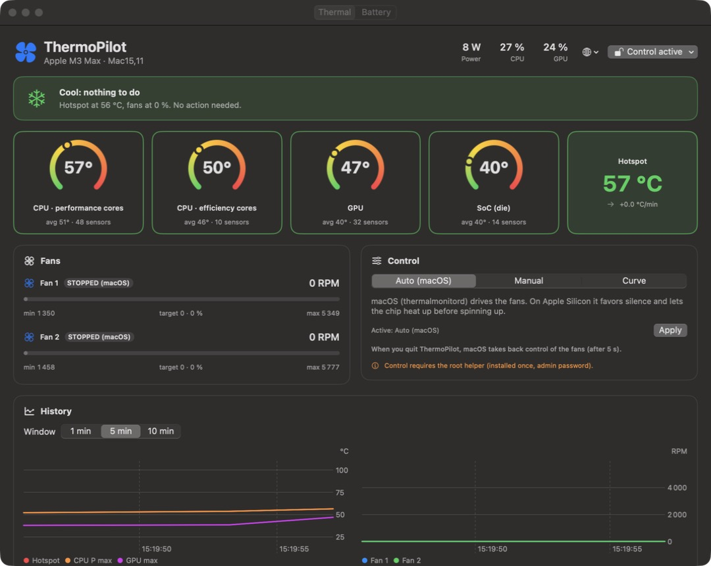
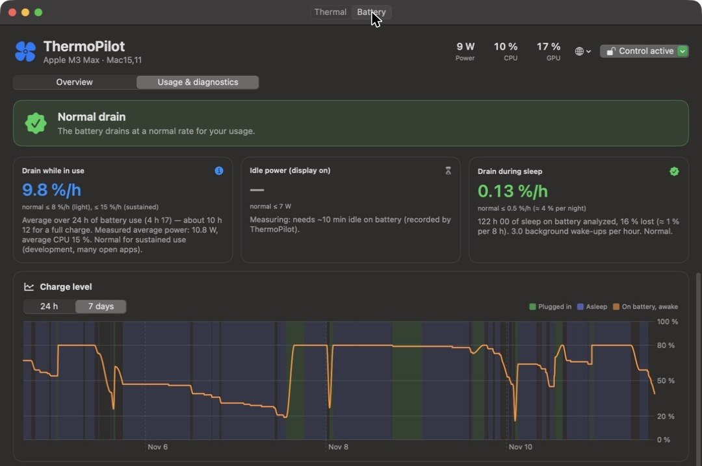

<p align="center">
  
</p>

<h1 align="center">ThermoPilot</h1>

<p align="center">
  <b>Temperatures, fans and battery health for Apple Silicon Macs — right in your menu bar.</b><br>
  Free, open source, and lighter than the problems it watches (&lt; 0.2 % CPU).
</p>

<p align="center">
  <a href="../../releases/latest"></a>
  <a href="../../releases"></a>
  
  
  <a href="LICENSE"></a>
  <a href="CONTRIBUTING.md"></a>
</p>

<p align="center">
  <a href="../../releases/latest"><b>⬇️ Download</b></a> ·
  <a href="#-features">Features</a> ·
  <a href="#-install">Install</a> ·
  <a href="#-contributing">Contribute</a> ·
  <a href="#%EF%B8%8F-roadmap">Roadmap</a> ·
  <a href="README.fr.md">Français</a>
</p>

<p align="center">
  <a href="assets/demo.mp4"></a><br>
  <sub>▶️ <a href="assets/demo.mp4">Watch the 30-second demo with sound</a></sub>
</p>

---

## Why ThermoPilot?

My M3 Max MacBook Pro runs hot under load, and some days the battery drained much faster than others, without telling me why.
The existing tools each cover one piece: fan control, temperatures, or charge limiting. **ThermoPilot does all three, and also explains what is happening.**

- 🌡️ **See** every temperature sensor of your chip, live.
- 🌀 **Control** your fans: let macOS decide, set a speed, or pick a cooling curve.
- 🔋 **Protect** your battery: limit charging to 80 %, with heat protection.
- 📉 **Understand** your battery drain: *is it normal?* Which apps drain it, and what keeps your Mac awake at night?

It's a native SwiftUI app with a Rust engine, it lives in your menu bar, and it's **free and open source** (MIT).
**The goal is to keep improving it together, so ideas, feedback and contributions are very welcome.**

## ✨ Features

<table>
<tr>
<td width="50%" valign="top">

### 🌡️ Thermal dashboard
- CPU performance & efficiency cores, GPU, SoC, SSD, battery, Wi-Fi, palm rest, airflow — plus every raw SMC key
- Fan speed, CPU/GPU load, system power, 1/5/10-min history charts
- **Advisor**: tells you when it's worth spinning the fans up (and when it isn't)

### 🌀 Fan control
- **Auto** (macOS), **Manual** (0–100 %) or **Curve** (Silent / Balanced / Performance)
- **Safe by design**: fans go back to macOS 5 s after you quit, before sleep, or if the helper stops — and are forced to max above 100 °C

</td>
<td width="50%" valign="top">



</td>
</tr>
<tr>
<td width="50%" valign="top">



</td>
<td width="50%" valign="top">

### 🔋 Battery: lifespan & runtime
- **Charge limiter** (50–100 %) with heat protection, verified against the real battery current
- Health computed the same way macOS does, plus cycles, temperature and power in/out
- One-click **power settings**: energy mode, display/system sleep, Power Nap — with backup & restore

### 📉 "Is my drain normal?"
- Compares your drain **in use**, **idle** and **asleep** against healthy baselines
- 7-day history from the macOS power log, available right after install
- **Apps draining the battery** (Wh, share, CPU time), apps preventing sleep, what wakes your Mac at night
- Targeted, one-click fixes

</td>
</tr>
</table>

**Also:**
- Menu bar only: the Dock icon shows up only while the dashboard is open.
- English and French interface, following your macOS language.
- Notifications when your Mac gets hot.
- An adaptive engine that slows down when nobody is looking.

## 📦 Install

1. **[Download the latest DMG](../../releases/latest)**, open it and drag **ThermoPilot** into **Applications**.
2. **First launch**: the app is not notarized by Apple yet (no paid developer account), so macOS blocks it the first time.
   - **System Settings › Privacy & Security**, scroll down and click **Open Anyway**, or
   - in Terminal:
     ```bash
     xattr -dr com.apple.quarantine /Applications/ThermoPilot.app
     ```
3. ThermoPilot appears in your **menu bar**. Open the dashboard from its menu.
4. *(Optional)* To **control fans and charging**, click the status pill at the top right of the dashboard › **Install root helper…** (admin password, once). Without it, ThermoPilot runs read-only.

**Requirements:** Apple Silicon Mac (M1 → M4), macOS 15 Sequoia or later.
**Uninstall:** status pill › **Uninstall root helper…**, then move the app to the Trash.

## 🔒 Is it safe?

Controlling fans and charging means writing to the Mac's SMC, so here is exactly what ThermoPilot does:

- A small **root helper** (LaunchDaemon) only accepts connections from **your user account** and root.
- The fans always go **back to macOS** when you quit the app (after 5 s), before sleep, or if the helper stops. Above **100 °C** they are forced to maximum.
- The power adapter is always **re-enabled before sleep**, when the battery drops to 15 %, and when the helper stops.
- Only a short **whitelist** of `pmset` settings can be changed, and your previous settings are saved so you can restore them.
- **Everything is open source**: [`engine/src`](engine/src) shows every key that gets written.

ThermoPilot is provided as is, without warranty. Use it at your own risk.

## 🤝 Contributing

**ThermoPilot is meant to grow with its community.** Every contribution helps, big or small, and you don't need to write code:

- 🧪 **Test it on your Mac.** It has only been tested on an **M3 Max MacBook Pro**. SMC keys differ between chips, so reports from M1, M2 and M4 Macs, Pro/Max/Ultra chips and Mac mini/Studio owners are gold.
  → [Open a hardware report](../../issues/new?template=hardware_report.yml) with the output of `fanengine dump`.
- 🐛 **Report bugs** and 💡 **suggest features** in [Issues](../../issues).
- 🌍 **Translate** the app into your language.
- 🛠️ **Send a pull request.** **[CONTRIBUTING.md](CONTRIBUTING.md)** explains how to build, how the project is organized, and where to start.

## 🗺️ Roadmap

Where help is especially welcome:

- [ ] Verified support for **M1 / M2 / M4** sensor and fan keys
- [ ] **Charge limiter** on chips that expose a charge-pause key (`CH0B` / `CHTE`)
- [ ] **Apple notarization** and a **Homebrew cask**
- [ ] **Launch at login** and automatic updates
- [ ] More **languages** (string catalogs)
- [ ] Customizable menu-bar item and **widgets**
- [ ] Battery history export (CSV)

Have another idea? [Open an issue](../../issues/new?template=feature_request.yml), and let's build it together.

## 🏗️ How it works

```
┌──────────────────────┐   JSON lines / Unix socket   ┌───────────────────────────┐
│ ThermoPilot.app      │ ───────────────────────────▶ │ fanengine (Rust)          │
│ SwiftUI + Charts     │   status / set_mode / usage  │ IOKit → AppleSMC          │
│ window + menu bar    │ ◀─────────────────────────── │ sensors, fans, battery,   │
└──────────────────────┘                              │ advice, usage recorder    │
                                                      └───────────────────────────┘
```

- **`app/`**: SwiftUI interface (dashboard, battery tab, menu bar).
- **`engine/`**: Rust engine that reads and writes the SMC through IOKit, records battery usage and generates advice. It runs as a root LaunchDaemon (full control) or as a user process (read-only).
- **Efficient**: 1 s cadence while a window is visible, 5 s in the menu bar, 10 s when the app is closed. It reads only the sensors it needs and spawns no processes routinely (helper ≈ 0.07–0.18 % CPU).

### Build from source

Requires Rust (stable) and Xcode 16+ / Swift 6.

```bash
git clone https://github.com/lilian-hurst/ThermoPilot.git
cd ThermoPilot
./build.sh
open build/ThermoPilot.app
```

The engine CLI is handy for debugging and hardware reports:

```bash
engine/target/release/fanengine status   # JSON snapshot
engine/target/release/fanengine dump     # every SMC key (attach it to hardware reports)
engine/target/release/fanengine battery  # battery, limiter, pmset, consumers, tips
engine/target/release/fanengine usage    # battery usage report & drain diagnostics
engine/target/release/fanengine bench    # cost of each engine read
```

## ⭐ Support the project

If ThermoPilot helps you, **star the repo**: it helps others find it. And share it with a friend whose Mac sounds like a jet engine. 🛫

## License

[MIT](LICENSE) © lilian-hurst
